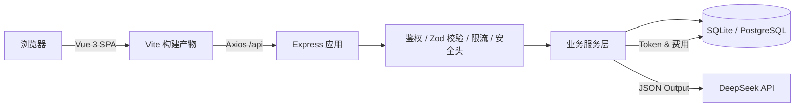
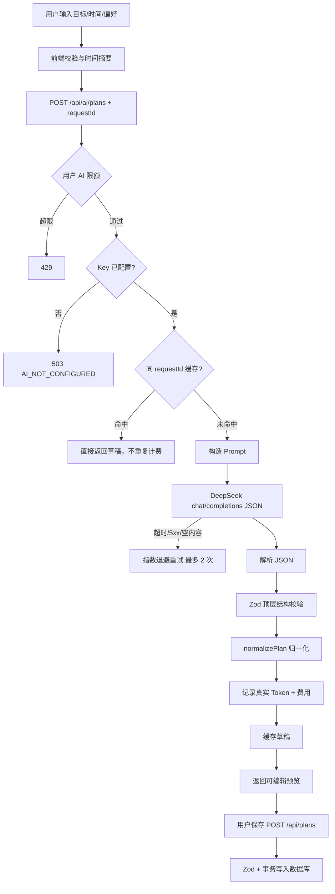
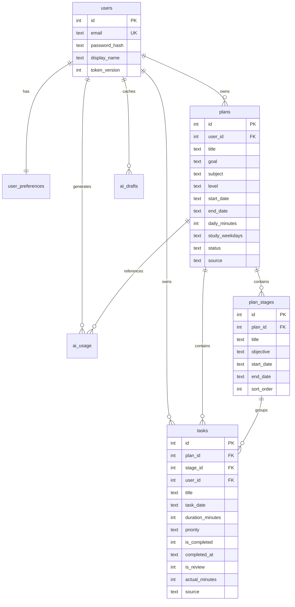
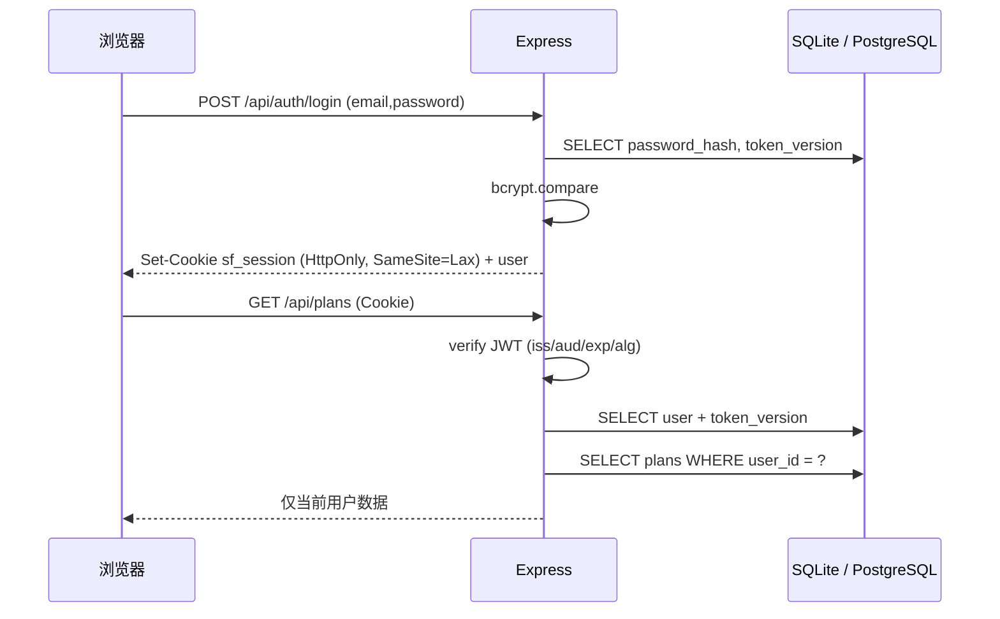
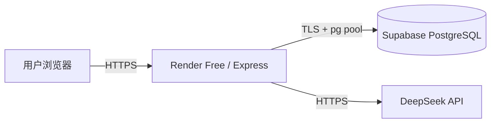
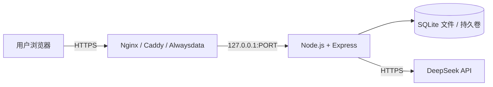

# 架构与技术决策

## 1. 总览

StudyFlow AI 是一个前后端分离、单仓库部署的全栈应用。开发时 Vite 代理 `/api` 到 Express；生产时 Express 同时提供 REST API 与 `dist/` 静态页面，浏览器与 API 同源，Cookie 会话最简单也最安全。



### 技术选型

| 层 | 选型 | 原因 |
| --- | --- | --- |
| 前端 | Vue 3 + Vite + JavaScript | 用户已掌握 Vue 3；Vite 快；无 TypeScript 编译负担 |
| 路由 / 状态 | Vue Router 5 + Pinia 4 | 官方生态，受保护路由与会话状态清晰 |
| HTTP | Axios | 统一拦截器、超时、请求取消、错误归一化 |
| 样式 | 原生 CSS + CSS Variables | 完全掌控视觉，不引入 UI 框架；Design Token 统一 |
| 图标 | lucide-vue-next | 轻量、统一线性风格、按需 tree-shaking |
| 后端 | Node.js + Express 4 | 简单可靠，部署成本低 |
| 数据库 | SQLite（本地）/ Supabase PostgreSQL（生产） | 本地零配置；生产用托管 Postgres，免费托管且数据不依赖单机磁盘；同一套异步数据层切换 |
| 校验 | Zod | 前后端字段约束明确，错误信息可用 |
| 鉴权 | JWT + HttpOnly Cookie | 避免 localStorage 被 XSS 直接读取；HttpOnly 降低 Token 泄露面 |
| 密码 | bcryptjs (cost 12) | 纯 JS、跨平台安装简单，避免原生编译依赖 |
| AI | DeepSeek `/chat/completions` | 用户已有 Key；OpenAI 兼容格式；JSON Output 稳定 |

---

## 2. 代码分层

### 后端

```text
routes/        只负责 HTTP：解析已验证参数、调用 service、返回 JSON
schemas/       Zod：输入边界与跨字段规则
middleware/    requestId、鉴权、校验、限流、CORS/Origin、Helmet、错误处理
services/      业务规则：归属校验、事务、日期归一化、AI 编排、统计
prompts/       版本化的 Prompt（生成 / 调整）
utils/         日期、文本清洗、成本、日志
db/            连接、schema、migrate
```

- 路由不直接写 SQL；服务层不依赖 `req/res`。
- 所有写入都先做归属检查（`plan.user_id = req.user.id` 或 `JOIN plans ...`）。
- 删除计划依赖数据库 `ON DELETE CASCADE`，同时服务层仍先确认计划属于当前用户。
- 错误使用 `AppError`（可安全暴露）与统一错误中间件；未知异常返回 500，不泄露堆栈。

### 前端

```text
api/            Axios 实例 + 按领域拆分的 API 模块；错误归一化为 ApiError
stores/         auth（会话/偏好）、ui（toast）
views/          页面级编排：加载、空状态、错误、交互
components/     可复用 UI、表单、计划、任务、图表、插画
layouts/        AppShell（侧栏/移动导航）、AuthLayout
utils/          日期、格式化、校验（与服务端规则一致但独立）
assets/styles/  design tokens、reset/base、表单样式
```

- 页面不直接 `axios.get`，统一走 `api/` 模块。
- `http.js` 统一处理超时、网络错误、401 会话失效、请求取消、错误结构。
- 视觉 Token 全部来自 `tokens.css`；组件只消费变量，避免散落颜色与间距。

---

## 3. AI 计划流水线

这是项目最核心、也最容易出问题的部分。模型输出被视为**不可信输入**。



### `normalizePlan` 做了什么

1. 计划周期限制 1–366 天；调整时允许修改结束日期、每日时长、可学习日。
2. 阶段日期必须落在周期内；非法日期按阶段数量均分；阶段前后衔接且不重叠。
3. 任务日期必须落在周期内，并吸附到可学习日；无法吸附时回退到范围内的学习日。
4. 同一天任务总时长超过 `dailyMinutes` 时，按比例缩减；仍超出则移除低优先级任务。
5. 去重（日期 + 标题）、限制最多 160 个 AI 任务、限制单任务 5–480 分钟。
6. 阶段索引重新映射；缺失时按任务日期匹配阶段。
7. 记录所有自动调整，返回给前端展示，避免「悄悄改了用户计划」。

### 时间与日期

- 数据库存储 `YYYY-MM-DD` 日历日期；服务器使用 `APP_TIMEZONE` 计算「今天」和统计区间。
- 服务端日期运算使用 UTC 毫秒构造 `Date.UTC`，避免服务器时区导致跨日错误。
- 前端日期格式化使用本地日历，避免 `new Date('YYYY-MM-DD')` 的 UTC 偏移。

### 成本与幂等

- `ai_usage` 记录真实 Token、缓存命中、延迟、成功/失败、估算费用。
- 价格在 `.env` 配置，默认 Flash 高峰价（上限估算）。
- `requestId` 由前端 `crypto.randomUUID()` 生成；失败重试复用，修改条件后重新生成。
- 调整预览缓存键为 `${planId}:${requestId}`，避免不同计划共用同一个缓存结果。
- 缓存 TTL 默认 30 分钟，过期自动清理。

---

## 4. 数据模型



设计取舍：

- `tasks` 冗余 `user_id`：统计与权限查询更直接，也避免只依赖 JOIN。
- `stage_id` 可空：AI 调整或用户移动任务后，保留任务但允许暂不归属阶段（`ON DELETE SET NULL`）。
- `plans.risks` / `study_weekdays` 以 JSON 文本存储：关系数据库没有统一数组类型，读取时统一解析并有默认值。
- `ai_usage` 独立于 `ai_drafts`：一个记录成本，一个负责幂等，语义清晰。
- 状态与优先级在数据库层有 `CHECK` 约束；API 层还有 Zod 校验。

---

## 5. 会话与安全边界



- Cookie 不进入 JS，降低 XSS 窃取会话风险。
- 前端不保存 Token；刷新后 `/auth/session` 恢复登录态。
- `/auth/session` 对匿名用户返回 200 + null，避免控制台无意义的 401；受保护接口仍返回 401。
- 修改密码递增 `token_version`，旧 Token 立即失效；当前会话拿到新 Cookie。
- CSRF：SameSite=Lax + 非 GET 请求 Origin 校验；生产建议同源部署。
- CSP：生产环境 `script-src 'self'`、`object-src 'none'`、`frame-ancestors 'none'`。

---

## 6. 前端设计系统

- `tokens.css`：暖白/浅灰背景、低饱和薰衣草/薄荷/蜜桃强调色、间距、圆角、阴影、动效曲线。
- `base.css`：reset、排版、布局工具、空状态、骨架、页面过渡、`prefers-reduced-motion`。
- `forms.css`：所有输入/选择/文本域的 label、错误、提示、焦点环统一。
- 组件通过 scoped CSS 消费变量；没有全局 UI 框架。
- 响应式断点：`1180`（统计卡）、`1100`（详情侧栏）、`1000/980`（双栏转单栏）、`900`（侧栏转移动底栏）、`760/700/640`（表单/弹窗）、`560`（窄屏细节）。
- 移动端：底部导航 + 居中的「新建」按钮、详情页底部安全区、弹窗改为底部抽屉。
- 无障碍：跳转链接、语义化 landmark、label 关联、`aria-invalid`、`aria-pressed`、focus trap、Esc 关闭、焦点归还、`aria-live` toast、减少动态效果。
- 图标统一 lucide 线性风格，stroke-width 1.8。

### 设计取舍

- 不使用玻璃拟态、发光和大面积渐变堆叠；只在 AI 提示、CTA 与插画背景使用极轻的渐变。
- 不使用图表库：趋势图和星期图用 SVG/CSS 手写，减少依赖、完全控制视觉与可访问性。
- 可爱感来自插画、圆角、柔和色彩和微文案，而不是装饰元素堆叠。
- 页面动效只用于反馈与层级变化，时长 140–380ms，并完整支持 `prefers-reduced-motion`。

---

## 7. 关键边界与失败策略

| 场景 | 处理 |
| --- | --- |
| 未配置 API Key | 503 `AI_NOT_CONFIGURED`，前端显示具体配置步骤，不生成假数据 |
| 上游 401/402 | 分别提示检查 Key / 余额，不重试 |
| 上游 429/5xx/超时 | 指数退避重试；最终返回 429/502/504 |
| 输出被截断 | 502 `AI_OUTPUT_TRUNCATED`，建议缩短周期或减少任务 |
| 输出不是 JSON / 结构缺失 | 502 `AI_BAD_OUTPUT`，记录失败用量，不写库 |
| 网络中断但模型已成功 | 复用同一 `requestId` 可命中缓存，避免重复计费 |
| 客户端取消 | AbortController 中断请求；服务端可能已完成并缓存，费用按实际记录 |
| 计划日期调整导致任务越界 | 409 `PLAN_RANGE_CONFLICT`，要求先调整任务 |
| 用户访问他人数据 | 统一 404，不泄露资源是否存在 |
| 重复提交任务 / 计划保存 | 前端 loading + 后端唯一约束/参数校验 |

---

## 8. 部署拓扑

### Supabase + Render Free（推荐）



- Render 免费实例无持久化磁盘，数据库完全在 Supabase
- 连接串使用 **Session Pooler**（IPv4）；`DATABASE_SSL=true`
- 启动时自动建表，事务级 advisory lock 防止多实例并发建表
- 免费限制：Supabase 500MB、7 天无活动暂停；Render 空闲休眠

### 单机 / VPS / Alwaysdata（SQLite 备选）



单实例运行，SQLite 放在持久化磁盘；反向代理设置 `X-Forwarded-*`，应用配置 `TRUST_PROXY=1`。真正水平扩展还需要 Redis 限流和共享任务队列。
